

<picture><source media="(prefers-color-scheme: dark)" srcset="assets/hero-dark.svg"></picture>

<picture><source media="(prefers-color-scheme: dark)" srcset="assets/social-l-dark.svg"></picture><a href="https://t.me/"><picture><source media="(prefers-color-scheme: dark)" srcset="assets/social-1-dark.svg"></picture></a><a href="https://discord.com/"><picture><source media="(prefers-color-scheme: dark)" srcset="assets/social-2-dark.svg"></picture></a><a href="https://x.com/"><picture><source media="(prefers-color-scheme: dark)" srcset="assets/social-3-dark.svg"></picture></a><picture><source media="(prefers-color-scheme: dark)" srcset="assets/social-r-dark.svg"></picture>

<picture><source media="(prefers-color-scheme: dark)" srcset="assets/about-dark.svg"></picture>

<picture><source media="(prefers-color-scheme: dark)" srcset="assets/stack-dark.svg"></picture>

<a href="https://github.com/rapid4ik/rapid4ik.github.io"><picture><source media="(prefers-color-scheme: dark)" srcset="assets/project-rapid4ik-github-io-dark.svg"></picture></a>&nbsp;<a href="https://github.com/rapid4ik/MyJavaHelpersClasses"><picture><source media="(prefers-color-scheme: dark)" srcset="assets/project-myjavahelpersclasses-dark.svg"></picture></a>

<a href="https://github.com/rapid4ik/SlCore"><picture><source media="(prefers-color-scheme: dark)" srcset="assets/project-slcore-dark.svg"></picture></a>&nbsp;<a href="https://github.com/rapid4ik/YouTube-Anti-Freeze"><picture><source media="(prefers-color-scheme: dark)" srcset="assets/project-youtube-anti-freeze-dark.svg"></picture></a>

<picture><source media="(prefers-color-scheme: dark)" srcset="assets/stats-dark.svg"></picture>

<picture><source media="(prefers-color-scheme: dark)" srcset="assets/streak-dark.svg"></picture>

<picture><source media="(prefers-color-scheme: dark)" srcset="assets/wave-dark.svg"></picture>

<a href="https://example.com"><picture><source media="(prefers-color-scheme: dark)" srcset="assets/button-1-dark.svg"></picture></a>&nbsp;&nbsp;<a href="https://github.com/rapid4ik?tab=repositories"><picture><source media="(prefers-color-scheme: dark)" srcset="assets/button-2-dark.svg"></picture></a>

<a href="https://metawka.github.io/expressive-profile/?from=rapid4ik"><picture><source media="(prefers-color-scheme: dark)" srcset="assets/credit-dark.svg"></picture></a>

